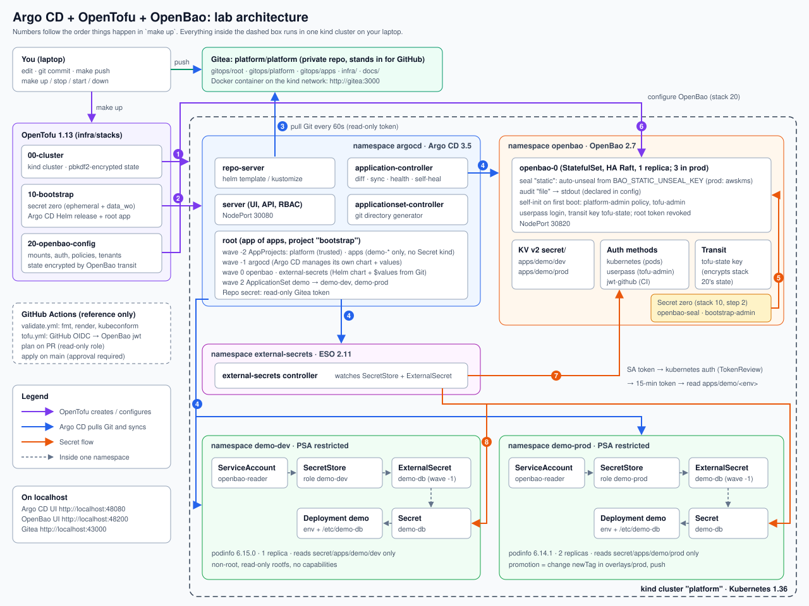

# 11 · Architecture: the whole system on one page

## Reading the numbers

The numbers follow the order things happen when you run `make up`.

1. **OpenTofu stack 00** creates the kind cluster. Its state is encrypted
   with a passphrase key (`pbkdf2`).
2. **OpenTofu stack 10** creates OpenBao's *secret zero* (the seal key and
   the first admin password) with ephemeral values and write-only
   attributes, so neither is ever stored in state. It then installs Argo CD
   with Helm and creates the `root` Application. This is the last thing
   OpenTofu does *inside* Kubernetes.
3. **Argo CD pulls Git**: the repo-server clones the private Gitea repo with a
   read-only token every 60 seconds and renders Helm charts and Kustomize
   overlays.
4. **Argo CD syncs in waves**: AppProjects (-2), Argo CD itself (-1),
   OpenBao and External Secrets (0), then the demo ApplicationSet (2), which
   generates `demo-dev` and `demo-prod`. A health check on Applications makes
   each wave wait until the previous one is actually Healthy.
5. **OpenBao starts itself**: it auto-unseals with the static seal key, then
   runs its declarative self-initialization once. That creates the
   `tofu-admin` login and the `tofu-state` transit key, after which the
   temporary root token is revoked.
6. **OpenTofu stack 20** logs in as `tofu-admin` and configures OpenBao: the
   KV mount, Kubernetes auth, one policy, role and seeded secret per
   app/environment, and the CI roles. Its own state is encrypted using
   OpenBao's transit key.
7. **External Secrets logs in per namespace**: for each `SecretStore` it
   presents a short-lived ServiceAccount token for `openbao-reader`. OpenBao
   checks it with the Kubernetes TokenReview API and returns a 15-minute
   token that can read only that environment's path.
8. **External Secrets writes the Kubernetes Secret** `demo-db`. The pod
   receives it as an environment variable (read at start) and as a mounted
   file (updated in place on rotation).

## The boundaries that make it production-shaped

| Boundary | Enforced by |
|---|---|
| Nothing outside the cluster can deploy to it | Pull model: CI writes to Git only, Argo CD pulls |
| The root app can only create Argo CD objects | AppProject `bootstrap` |
| Product apps stay in `demo-*` namespaces and can't commit Secrets | AppProject `apps` (destinations + Secret kind blacklist) |
| dev can't read prod secrets | One OpenBao role and policy per namespace and ServiceAccount |
| No secret in Git | ExternalSecret references only |
| No secret in OpenTofu state | Ephemeral values + write-only attributes, plus encrypted state |
| No root token sitting anywhere | OpenBao self-initialization revokes it |
| Pods can't run as root | Pod Security Admission `restricted` on app namespaces |
| Drift doesn't survive | `selfHeal: true` |

## What changes in a real cloud

The shape stays the same; the boxes get swapped (details in
[doc 10](10-production-checklist.md)):

- kind → EKS (stack 00 becomes VPC + EKS + node groups).
- Gitea → GitHub, with branch protection and the workflows in
  `.github/workflows/`.
- `seal "static"` → `seal "awskms"`, so secret zero shrinks to an IAM role.
- `tofu-admin` userpass → GitHub OIDC for CI (step 6) and SSO for humans.
- One replica each → HA Argo CD, 3-node OpenBao Raft across zones,
  scheduled snapshots.
- KV passwords → OpenBao's database secrets engine issuing per-pod
  credentials.

That's the end of the lab. A good next exercise is replacing the demo's
static password with OpenBao's database secrets engine against a small
Postgres. After that, add KubeRay or the Spark operator as a platform app and
give a RayCluster its S3 credentials through an ExternalSecret.
